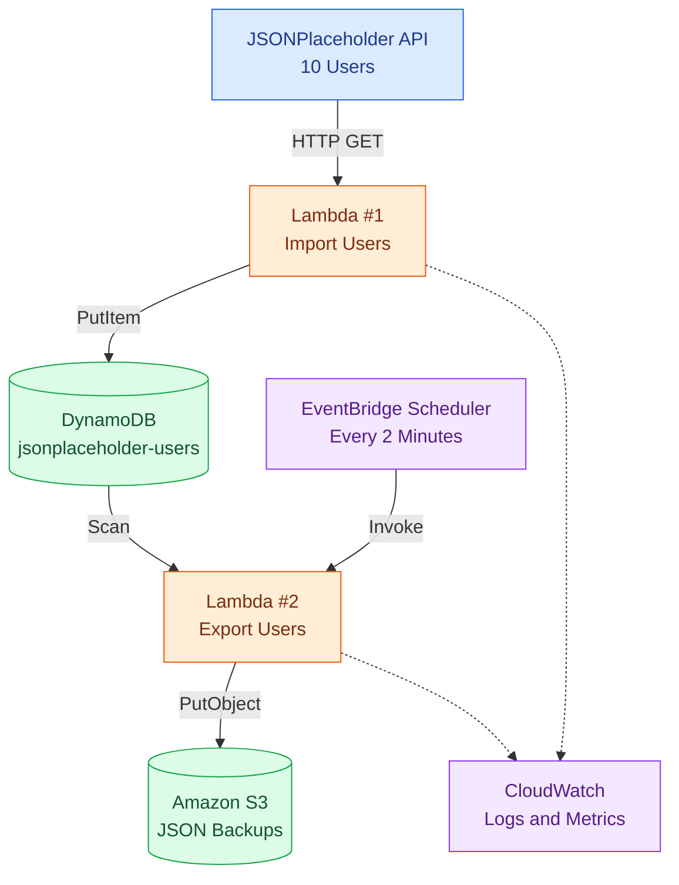

# AWS Lambda, DynamoDB & Scheduled S3 Backup

**Date:** November 20, 2026  
**Region:** Asia Pacific (Mumbai) — `ap-south-1`

## 1. Project Overview

This assignment implements a serverless AWS pipeline that retrieves 10 users from the JSONPlaceholder API, stores them in DynamoDB, and creates JSON backups in Amazon S3 using AWS Lambda and EventBridge Scheduler.

### Architecture

## 2. Implementation and Results

### 2.1 DynamoDB Setup

Created the `jsonplaceholder-users` table using `id` as the Number partition key.

**DynamoDB Table:**

**Stored Records:**

The table contains 10 user records.

### 2.2 Lambda #1 — Import Users

**Function:** `fetch-jsonplaceholder-user`

The first Lambda retrieves users from the JSONPlaceholder API and stores them in DynamoDB using `PutItem`.

**Result:** HTTP 200, 10 users saved successfully.

### 2.3 IAM Permissions

Configured separate IAM execution roles:

- Lambda #1: `dynamodb:PutItem`
- Lambda #2: `dynamodb:Scan`, `s3:PutObject`
- CloudWatch logging permissions for both functions

**Lambda #2 IAM Policy:**

### 2.4 Lambda #2 — Export to S3

**Function:** `export-dynamodb-to-s3`

The second Lambda scans DynamoDB and exports the records as timestamped JSON files.

**Environment Variables:**

**Test Result:** HTTP 200, 10 records exported successfully.

**S3 Bucket:** `student-lambda-backups-kabbo2026`

Multiple JSON files were created during testing.

### 2.5 EventBridge Scheduler

Created a recurring EventBridge schedule named `dynamodb-backup-every-2min`.

**Configuration:**
- Schedule: `rate(2 minutes)`
- Target: `export-dynamodb-to-s3`
- Flexible time window: Off

The schedule was configured to invoke Lambda #2 automatically every two minutes.

### 2.6 CloudWatch Monitoring

CloudWatch log groups were created for both Lambda functions. CloudWatch provides execution logs and metrics to help monitor errors and function performance.

## 3. Assignment Questions and Answers

**Q1. Difference between Lambda and Scheduler execution roles?**

Lambda's execution role allows access to DynamoDB and S3. Scheduler's execution role allows EventBridge to invoke Lambda.

**Q2. Why doesn't running Lambda #1 twice create 20 users?**

`PutItem` replaces records with matching partition keys, keeping 10 unique users.

**Q3. Why use unique timestamps and request IDs?**

To create unique backup filenames and prevent overwriting previous exports.

**Q4. Difference between logs and metrics?**

Logs contain execution details, while metrics measure invocations, errors, and duration.

**Q5. What if DynamoDB is deleted but S3 backups remain?**

The JSON records remain in S3, but the original table configuration and indexes cannot be automatically recovered from JSON alone.

**Q6. Why is a two-minute export unsuitable for large databases?**

Frequent scans consume resources, increase costs, and do not guarantee consistent backups. DynamoDB Point-in-Time Recovery (PITR) is better for production.

## 4. Conclusion

The AWS serverless pipeline was implemented and successfully tested. Lambda #1 saved 10 users in DynamoDB, and Lambda #2 exported their records to JSON files in S3.

EventBridge Scheduler was configured for recurring backups, while CloudWatch log groups were available for monitoring.

The screenshots demonstrate successful manual tests and the configured schedule. Separate evidence is needed to confirm two automated exports and the schedule's final disabled status.
