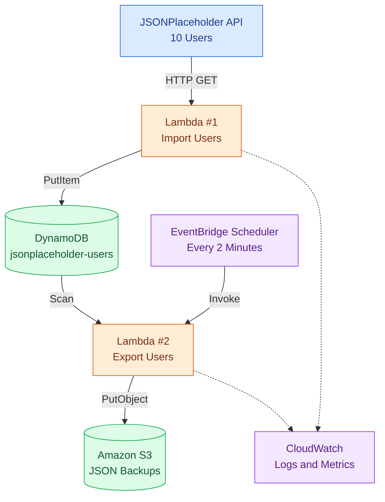

# AWS Lambda, DynamoDB & Scheduled S3 Backup

**Date:** November 20, 2026  
**Region:** Asia Pacific (Mumbai) — `ap-south-1`

## 1. Project Overview

This assignment implements a serverless AWS pipeline that retrieves 10 users from the JSONPlaceholder API, stores them in DynamoDB, and creates JSON backups in Amazon S3 using AWS Lambda and EventBridge Scheduler.

### Architecture

## 2. Implementation and Results

### 2.1 DynamoDB Setup

Created the `jsonplaceholder-users` table using `id` as the Number partition key.

**DynamoDB Table:**

**Stored Records:**

The table contains 10 user records.

### 2.2 Lambda #1 — Import Users

**Function:** `fetch-jsonplaceholder-user`

The first Lambda retrieves users from the JSONPlaceholder API and stores them in DynamoDB using `PutItem`.

**Result:** HTTP 200, 10 users saved successfully.

### 2.3 IAM Permissions

Configured separate IAM execution roles:

- Lambda #1: `dynamodb:PutItem`
- Lambda #2: `dynamodb:Scan`, `s3:PutObject`
- CloudWatch logging permissions for both functions

**Lambda #2 IAM Policy:**

### 2.4 Lambda #2 — Export to S3

**Function:** `export-dynamodb-to-s3`

The second Lambda scans DynamoDB and exports the records as timestamped JSON files.

**Environment Variables:**

**Test Result:** HTTP 200, 10 records exported successfully.

**S3 Bucket:** `student-lambda-backups-kabbo2026`

Multiple JSON files were created during testing.

### 2.5 EventBridge Scheduler

Created a recurring EventBridge schedule named `dynamodb-backup-every-2min`.

**Configuration:**
- Schedule: `rate(2 minutes)`
- Target: `export-dynamodb-to-s3`
- Flexible time window: Off

The schedule was configured to invoke Lambda #2 automatically every two minutes.

### 2.6 CloudWatch Monitoring

CloudWatch log groups were created for both Lambda functions. CloudWatch provides execution logs and metrics to help monitor errors and function performance.

## 3. Assignment Questions and Answers

## 3. Assignment Questions and Answers

### Q1. What is the difference between Lambda's execution role and Scheduler's execution role?

An execution role is an IAM role that gives an AWS service permission to perform certain actions.

**Lambda's execution role** determines what the Lambda function is allowed to do. For example, in our project, Lambda #1 needs permission to insert users into DynamoDB using `PutItem`. Lambda #2 needs permission to read DynamoDB using `Scan` and upload backup files to S3 using `PutObject`.

On the other hand, **Scheduler's execution role** allows EventBridge Scheduler to invoke Lambda #2 automatically every two minutes.

In simple terms, Lambda's role controls what the function can access, while Scheduler's role allows the Scheduler to start the function.

### Q2. Why doesn't running Lambda #1 twice create 20 DynamoDB users?

In DynamoDB, each user is identified by a unique partition key called `id`.

Our Lambda #1 retrieves the same 10 users from the JSONPlaceholder API each time it runs. When it saves the users using `PutItem`, DynamoDB checks their IDs.

If a user with the same ID already exists, `PutItem` replaces that existing record instead of adding another one.

For example, if user ID `1` already exists, running Lambda #1 again updates that user's record rather than creating a duplicate.

Therefore, running Lambda #1 twice still results in 10 unique users, not 20.

### Q3. Why do Lambda #2 backups have unique timestamps and request IDs?

Every time Lambda #2 runs, it creates a new JSON backup file in the S3 bucket.

A **timestamp** records when the backup was created, while a **request ID** uniquely identifies that particular Lambda execution.

These values are included in the filename to make each backup different from the others.

For example, two executions might create:

- `users-10-00-00-request1.json`
- `users-10-02-00-request2.json`

This prevents new backups from overwriting previous ones. It also makes it easier to identify and track individual backup files.

### Q4. What is the difference between `print()` logs and CloudWatch metrics?

Both logs and metrics help us monitor Lambda functions, but they provide different information.

**Logs** contain detailed messages about what happens while the Python code is running. For example, when Lambda #1 saves a user, the `print()` function can generate a message such as `Saved user 1: Leanne Graham`. These messages appear in CloudWatch Logs.

**Metrics**, on the other hand, provide numerical information about the function's performance.

For example:
- **Invocations:** How many times the Lambda function was executed.
- **Errors:** How many executions failed.
- **Duration:** How long the function took to execute.

In simple terms, logs explain what happened inside the function, while metrics show how frequently it runs and how well it performs.

### Q5. What happens if the DynamoDB table is deleted but the S3 JSON backups remain?

If the DynamoDB table is deleted, the user records stored inside that table will also be deleted.

However, the JSON backup files that were previously saved in S3 will remain available because S3 and DynamoDB are separate AWS services.

We could use those JSON files to recreate the user records in a new DynamoDB table.

However, JSON backups contain the exported data, not the complete database configuration. Information such as the original table settings, indexes, and access permissions cannot be automatically restored from those files alone.

Therefore, we would need to recreate the necessary table configuration and import the data manually or through a script.

### Q6. Why is exporting data every two minutes a poor backup strategy for large DynamoDB tables?

Exporting data every two minutes works well for our small assignment because the DynamoDB table contains only 10 users.

However, a real application might contain millions of records. Reading the entire database every two minutes would consume significant computing resources and DynamoDB read capacity.

This could increase AWS costs and cause Lambda functions to exceed their execution time or memory limits.

Another problem is that a DynamoDB `Scan` does not guarantee a consistent snapshot of the entire table if data is changing during the export.

For large production databases, **DynamoDB Point-in-Time Recovery (PITR)** and managed DynamoDB exports to S3 are better backup solutions because they are designed for reliable backup and recovery.

Therefore, our two-minute JSON export is useful for learning AWS automation, but it is not an ideal production backup strategy.

## 4. Conclusion

The AWS serverless pipeline was implemented and successfully tested. Lambda #1 saved 10 users in DynamoDB, and Lambda #2 exported their records to JSON files in S3.

EventBridge Scheduler was configured for recurring backups, while CloudWatch log groups were available for monitoring.

The screenshots demonstrate successful manual tests and the configured schedule. Separate evidence is needed to confirm two automated exports and the schedule's final disabled status.
